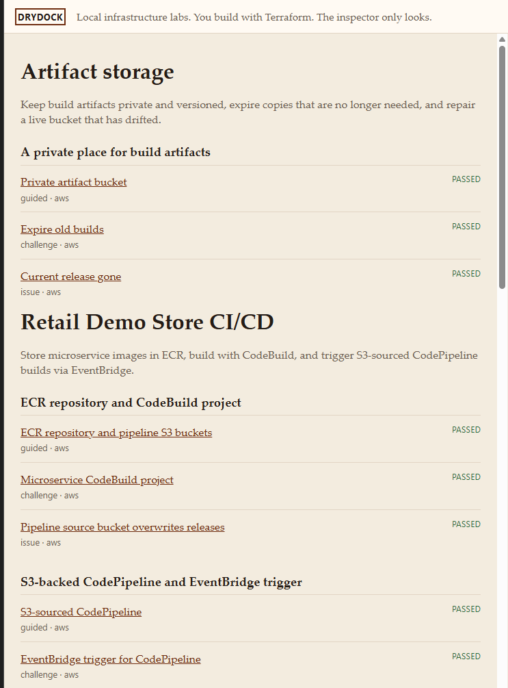
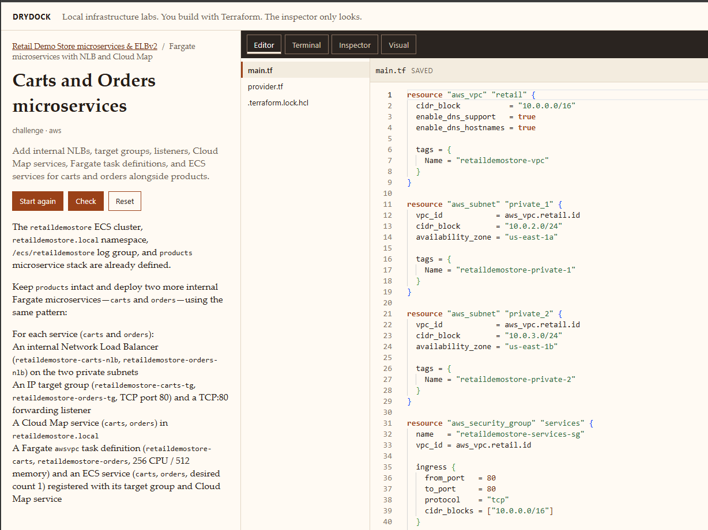
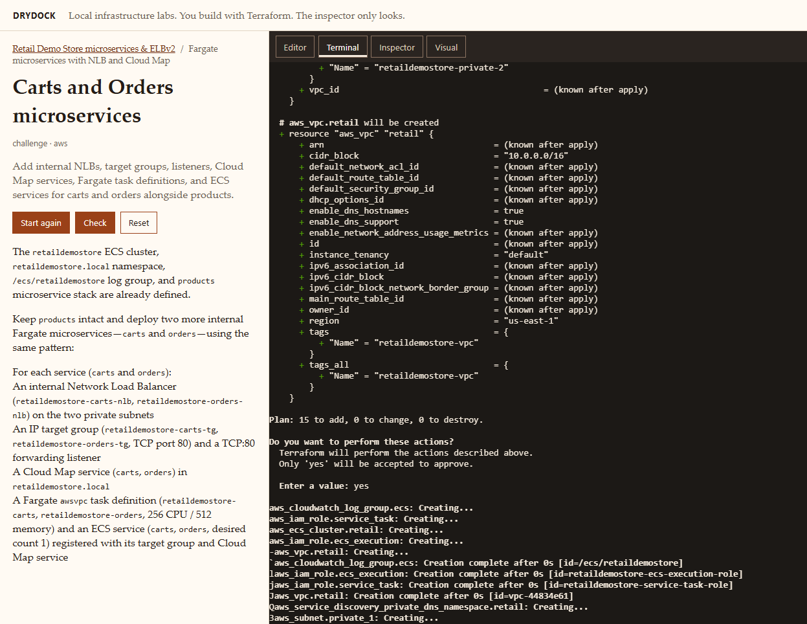
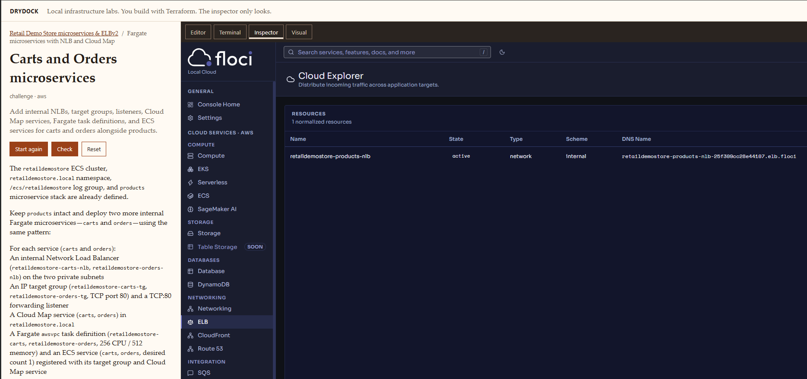
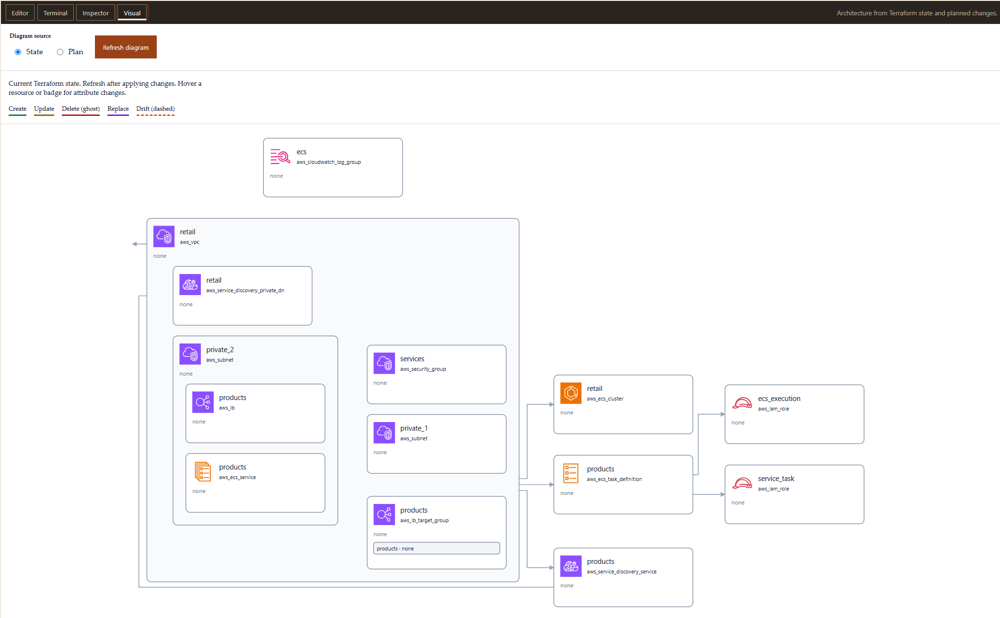
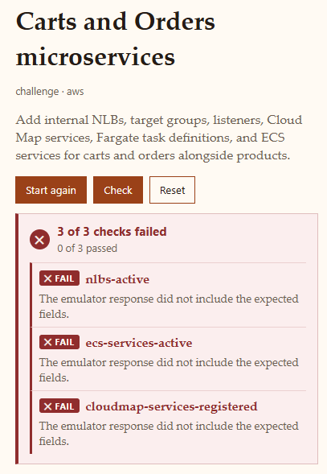

# Drydock

A local, Compose-run lab for infrastructure as code. Terraform and the AWS, Azure, gcloud, and OCI CLIs run in a toolbox container against [Floci](https://floci.io/) emulators. The lab UI is the only published port. The inspector is Floci UI, and it only looks.

The catalog has 7 paths, 17 scenarios, and 41 labs. Every lab targets AWS. Artifact storage is a short path about a private, versioned S3 bucket. The Retail Demo Store paths cover the store's VPC, web edge and Cognito auth, Fargate microservices, DynamoDB and search, API Gateway and EventBridge, and ECR, CodeBuild, and CodePipeline. One lab session is active. Starting a lab replaces the previous one and wipes that cloud. The starter files are the Terraform for that lab, including resources the scenario already treats as given.

## Screenshots

The home page is the catalog. A lab page puts the brief on the left and four tools on the right: Editor, Terminal, Inspector, and Visual. Check asks the emulator whether the lab's predicates hold.



The catalog lists every path, scenario, and lab, with its mode and cloud. **Passed** and **in progress** are stored in this browser under `drydock.progress`.



The editor is Monaco, backed by `terraform-ls` for completion, hover, diagnostics, and go to definition. It saves into the lab workspace, which is the directory the terminal uses.



The terminal is a shell in the toolbox: Terraform and the cloud CLIs, pointed at the session's emulators.



The inspector opens on the cloud service the lab names. The proxy allows reads. Create and delete actions are removed from the console schema.



Visual draws the session's Terraform state, or a fresh plan. Creates, updates, deletes, replacements, and drift are marked on the diagram. Details are below, under [Visual architecture](#visual-architecture).



Check runs the lab's predicates against the emulator. A pass marks the lab passed and links to the next lab. A failure leaves it in progress.

## Paths

Each scenario is a guided lab and then a challenge. Seven scenarios also end with an issue.

- **Artifact storage.** Keep build artifacts private and versioned, expire copies that are no longer needed, and repair a live bucket that has drifted. Scenario: A private place for build artifacts.
- **Retail Demo Store networking.** Build the multi-AZ VPC, public and private subnets, NAT egress, and S3 gateway endpoint. Scenarios: Multi-AZ VPC and subnets; Private subnet egress and S3 VPC endpoint.
- **Retail Demo Store web edge & auth.** Provision private S3 web asset buckets, CloudFront with Origin Access Control, and Cognito user and identity pools. Scenarios: Private web and API spec buckets; CloudFront CDN and Origin Access Control; Cognito shopper authentication.
- **Retail Demo Store microservices & ELBv2.** Run Fargate microservices in an ECS cluster behind internal Network Load Balancers with Cloud Map private DNS. Scenarios: ECS cluster and Cloud Map namespace; Internal Network Load Balancer and service discovery; Fargate microservices with NLB and Cloud Map.
- **Retail Demo Store data & search.** Provision DynamoDB catalog and order tables, a VPC-isolated managed OpenSearch domain, SSM parameters, and checkout secrets. Scenarios: DynamoDB catalog, carts, and orders tables; Product search security and indexing stream; Service parameters and payment secrets.
- **Retail Demo Store APIs & events.** Expose microservices behind an API Gateway v2 HTTP API with VPC Link, route events on EventBridge to SQS, and run checkout Lambda functions. Scenarios: API Gateway v2 HTTP API and VPC Link; EventBridge bus, archive, and SQS consumers; Checkout signing and order consumer Lambdas.
- **Retail Demo Store CI/CD.** Store microservice images in ECR, build with CodeBuild, and trigger S3-sourced CodePipeline builds via EventBridge. Scenarios: ECR repository and CodeBuild project; S3-backed CodePipeline and EventBridge trigger.

## Lab modes

A guided lab names the resources and links the vendor pages that say why. A challenge states the outcome and withholds the way there. An issue opens on a system that is already wrong, describes the symptoms the way a support ticket would, and leaves the cause unnamed.

Artifact storage is the short example of all three. The guided lab asks for an S3 bucket named `northline-artifacts`, with versioning enabled and public access blocked. The challenge asks for noncurrent versions to expire after 30 days and for incomplete multipart uploads to abort after 7 days. The issue opens on that bucket after a console change and a support ticket.

The solutions used by the acceptance test live under each lab's `solution/` directory. They are not copied into the workspace. An issue also has a `seed.yaml` that is applied before the learner arrives, and is not copied either.

```sh
./scripts/accept.sh
./scripts/accept.sh artifact-storage
```

`./scripts/accept.sh` builds the stack, applies every hidden solution inside the toolbox, and requires every check to pass. A path id limits the run to that path.

## GitHub Codespaces

[](https://codespaces.new/OWNER/REPO?quickstart=1)

Replace `OWNER/REPO` with the published repository, for example `octo-org/drydock`.

The badge is a [codespace deep link](https://docs.github.com/en/codespaces/setting-up-your-project-for-codespaces/setting-up-your-repository/facilitating-quick-creation-and-resumption-of-codespaces). `quickstart=1` resumes the newest codespace for the default branch, or creates one, and opens it in the VS Code web client. For another branch, use `https://codespaces.new/OWNER/REPO/tree/BRANCH-NAME`. To pin this dev container on that page, add `devcontainer_path=.devcontainer/devcontainer.json`.

The deep link does not set the machine size. [`hostRequirements`](https://docs.github.com/en/codespaces/setting-up-your-project-for-codespaces/configuring-dev-containers/setting-a-minimum-specification-for-codespace-machines) in `.devcontainer/devcontainer.json` does. It requires 4 CPUs, 16 GB of memory, and 32 GB of storage. Codespaces then offers only machines at or above that floor, and starts the smallest of them unless you pick a larger one on the options page. That default is 4 cores, 16 GB RAM, and 32 GB storage (`standardLinux32gb`). The 2-core, 8 GB machine is left out so the toolbox build and a running emulator have room. An options-page URL such as `https://github.com/codespaces/new?repo=REPOSITORY_ID&machine=standardLinux32gb` can pre-select a machine, but `REPOSITORY_ID` is numeric and the page still lets you change the selection, so the badge does not use it.

The dev container is Debian with Docker inside it. Compose publishes port 8080 on that container, and Codespaces forwards the port. Each start runs `.devcontainer/up.sh`, which waits for the daemon and then runs `docker compose up --build -d`. The first start builds the toolbox and pulls the Floci images. The postStartCommand terminal shows that progress.

When port 8080 is listening, Codespaces forwards it and opens the lab UI once. In the Ports tab the row is named Drydock. The address is `https://<codespace-name>-8080.app.github.dev`. In the VS Code desktop app the same UI is also at http://127.0.0.1:8080. Open a lab from that page.

A 4-core machine uses four of the included core-hours per hour. GitHub Free includes 120 core-hours a month. Stop the codespace at https://github.com/codespaces when you finish. To stop the containers and leave the codespace open:

```sh
docker compose --profile on-demand down
```

## Run

From the repository root. The Docker user needs permission to use the Docker socket.

```sh
docker compose up --build
docker compose --profile on-demand down
```

Open http://127.0.0.1:8080. Pick a lab and press Start lab. Edit Terraform in the Editor, `terraform apply` in the Terminal, then press Check. Reset restores that lab's starter and emulator. Start again does the same after a confirmation, and replaces whatever session is running.

`docker compose down` on its own leaves emulators running, and the network then stays up because those containers are still attached. `--profile on-demand` includes them. Compose has no `--destroy` flag. To remove the containers, the images this project built, and the lab data under `./data`:

```sh
docker compose --profile on-demand down --volumes --rmi local --remove-orphans
mkdir -p data/workspaces data/floci-az
find data/workspaces data/floci-az -mindepth 1 -delete
```

`--rmi local` leaves the pulled Floci images in place. `--volumes` does not delete `./data`, because those directories are bind mounts, so the `find` removes the workspaces and the Azure CA files.

Emulators stay stopped until a lab names them. Only one lab session is active. Starting a lab replaces the previous one and wipes that cloud. Lab progress is stored in the browser under the local storage key `drydock.progress`, so each visitor of this origin has a separate record. Clear site data for this origin to reset it.

## Other clouds

The published labs all set `clouds: [aws]`. Azure, GCP, and OCI provider bundles are generated and covered by unit tests. The acceptance test does not apply them. Before writing a lab for one of them, smoke it by hand:

- Azure: `FLOCI_AZ_TLS_ENABLED` is on. Session start runs `drydock-prepare-azure`, which downloads `http://floci-az:4577/_floci/tls-cert` into the workspace trust bundle and registers an `az` cloud named `drydock`. `azurerm` uses `metadata_host = "floci-az:4577"` and does not set `environment`, because provider 4.81 ignores that field when the metadata host is set. A TLS error on plan means the CA file was not written before init.
- GCP: Terraform custom endpoints follow the floci-gcp compatibility suite (`/storage/v1/`, `/v1/`, and `http://container.floci-gcp:4588/` for GKE). `GOOGLE_OAUTH_ACCESS_TOKEN=fake-token`. gcloud uses `CLOUDSDK_API_ENDPOINT_OVERRIDES_*`. Container calls from gcloud use the `/container/` prefix, not the host-mode URL.
- OCI: the provider reads `CLIENT_HOST_OVERRIDES` (not `TF_VAR_CLIENT_HOST_OVERRIDES`). The dummy key is `/opt/drydock/oci-dummy.pem`. Confirm a bucket apply reaches `http://floci-oci:4599` before trusting a new client name in that list.

## Layout

- `.devcontainer/` — Codespaces machine floor, Docker, and the start command
- `content/` — paths, scenarios, labs, checks, seeds, and the hidden solutions
- `services/labd` — catalog, sessions, emulator lifecycle, grader, inspector gate, terminal, Terraform language server
- `services/toolbox` — Terraform, provider mirror, and the four CLIs
- `services/diagrams` — state and plan diagrams for the Visual tab
- `services/web` — lab shell, editor, and per-browser lab progress
- `docs/screenshots/` — the images in this file
- `GLOSSARY.md` — the names this project uses for a path, a lab, a check, and the rest

## Visual architecture

Start an AWS lab and open **Visual**. **State** draws the resources recorded by Terraform. **Plan** runs a fresh `terraform plan -refresh=true -lock=false -input=false` and shows proposed creates (green), updates (amber), deletes (red ghosts), and replacements (purple). An orange dashed outline marks drift independently of the planned action. Hover a resource or configuration badge for attribute changes; sensitive attributes are redacted.

Resources sit inside their subnet and VPC when their references identify a parent. Configuration resources such as bucket versioning fold into badges. Unmapped resource types use an original generic icon. State references are an id/ARN matching heuristic, so this is an aid to understanding, not proof of connectivity or a substitute for the Inspector. Grading still reads the emulator. Use **Refresh diagram** after editing or applying Terraform. Plan mode never applies changes, but refreshes the emulator through Terraform and can take time. It does not acquire a state lock; wait for terminal operations to finish first.

`GET /api/diagram?mode=state|plan` returns a standalone SVG for the active session. Commands run in that session's toolbox workspace. Rendered SVG is cached by workspace, mode, and the hash of the Terraform JSON. Terraform is queried on each request, including a fresh plan in plan mode, so source edits and remote drift cannot be hidden by the render cache. Temporary saved plans are removed after use. The Visual tab loads only when selected.

The Docker build installs `services/diagrams` and downloads the official AWS icons. For local development, use Node 24:

```sh
cd services/diagrams
npm ci --ignore-scripts
npm run icons
npm run typecheck
npm test
```

If AWS rotates its icon archive and the download returns 404, update `PACK_URL` in `services/diagrams/scripts/fetch-aws-icons.ts` from the official AWS icon page. Generated `assets/` remain ignored by Git and Docker's build context. Original source is MIT licensed; vendor icons and elkjs retain their own terms (see `NOTICE`). No TerraVision code or assets are used.

Diagram tests include real Node-toolbox Terraform state and plan captures against Floci, covering every change action and API-induced drift, plus synthetic fixtures for sensitive values and module/index reference cases. Capture details are recorded in `services/diagrams/test/fixtures/README.md`.
